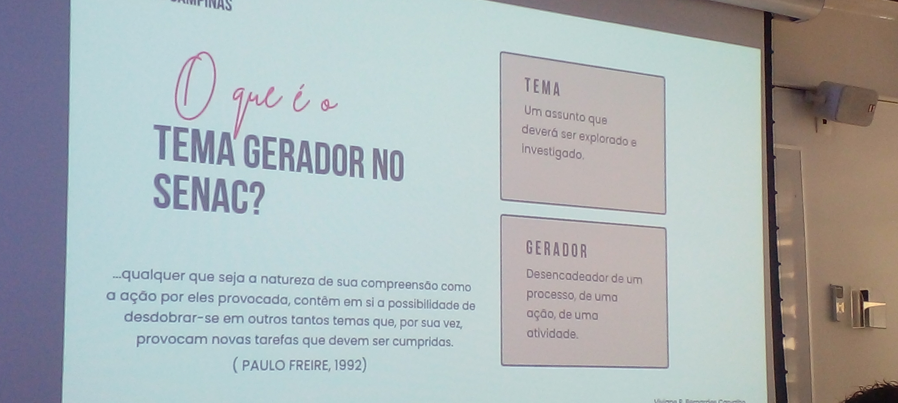
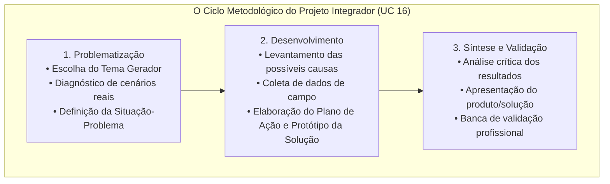
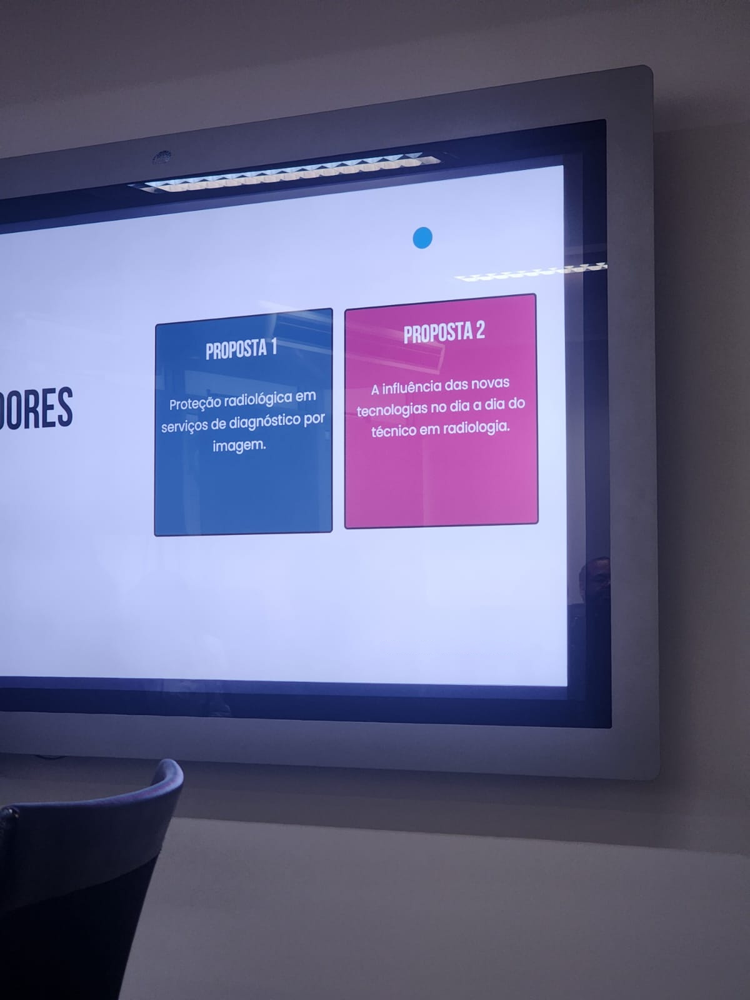
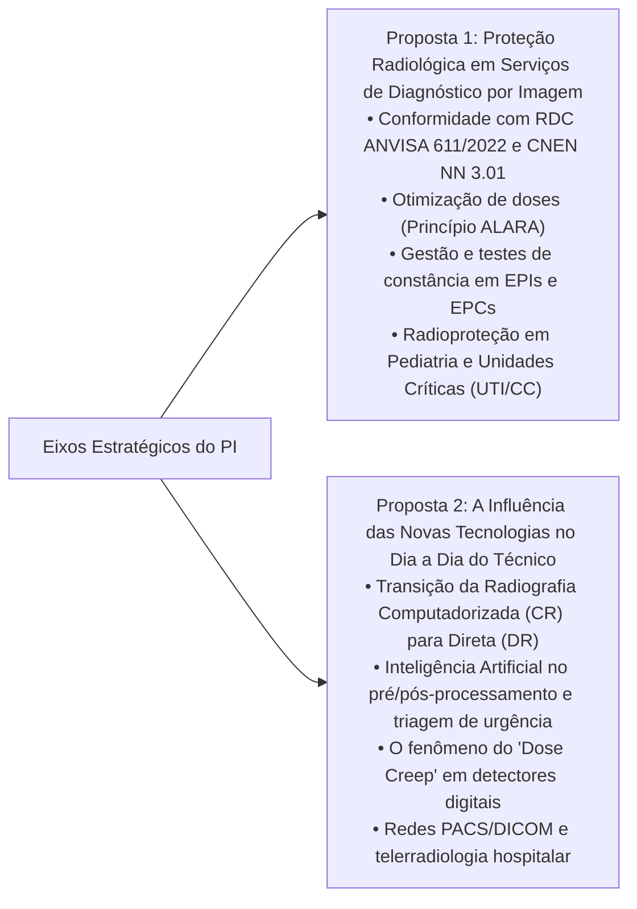
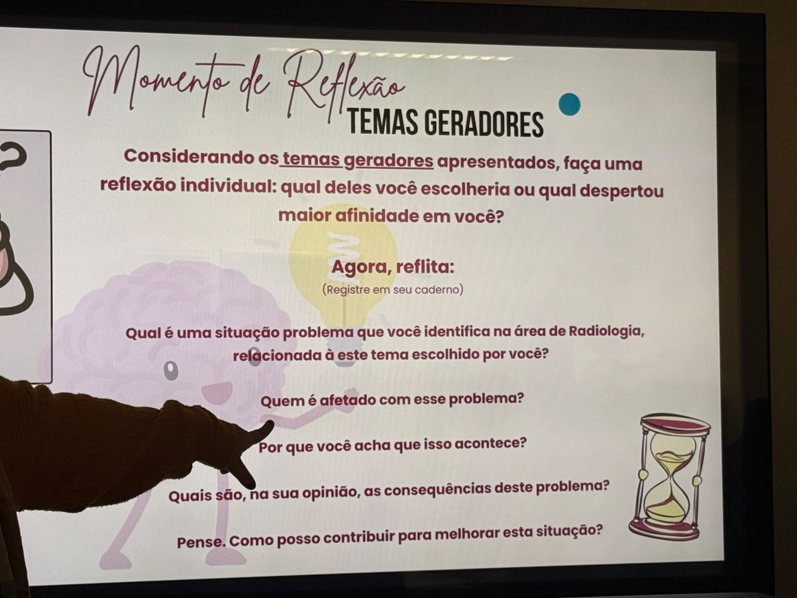
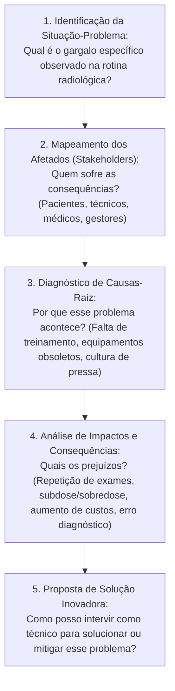

A formação técnica de excelência em radiologia diagnóstica vai muito além de saber operar consoles e posicionar pacientes sobre a mesa de exames. O mercado hospitalar contemporâneo exige profissionais capazes de **identificar problemas complexos na rotina de trabalho, investigar causas-raiz, aplicar normas regulamentadoras e propor soluções técnicas inovadoras e viáveis**.

No Senac Campinas, parte dessa competência estratégica é desenvolvida na **Unidade Curricular 16 (UC 16 — Projeto Integrador)**. Realizada em encontros mensais e iniciada em **27 de maio de 2026**, a UC 16 funciona como a espinha dorsal interdisciplinar que conecta todos os saberes da grade curricular ao longo do curso.

*Esquema da metodologia do Tema Gerador no Senac: problematização da realidade para construção de soluções técnicas.*

---

## 🎯 1. A Metodologia do Tema Gerador: Da Teoria à Prática

Fundamentado na pedagogia da autonomia e na problematização da realidade (Paulo Freire), o **Tema Gerador** no Senac não é um trabalho acadêmico meramente teórico ou compilatório de internet. Ele é um desafio real da prática profissional que provoca novas investigações e planos de ação:

> 💬 *"Qualquer que seja a natureza de sua compreensão como a ação por eles provocada, os temas geradores contêm em si a possibilidade de desdobrar-se em outros tantos temas que, por sua vez, provocam novas tarefas que devem ser cumpridas."* — **Paulo Freire (1992)**.

---

## 🔬 2. Os Dois Grandes Eixos Temáticos Apresentados para a Área da Radiologia

Nos encontros de orientação modular, foram estruturadas **duas propostas centrais de temas geradores**, refletindo os maiores desafios do diagnóstico por imagem atual:

*Os dois eixos estratégicos propostos para a turma no desenvolvimento do Projeto Integrador.*

### Detalhamento dos Eixos (Exemplos Hipotéticos):
1. **Eixo 1 — Proteção Radiológica e Biossegurança**:
   * Foco na segurança do paciente, dos trabalhadores da saúde (IOEs) e do público geral.
   * Investigação de lacunas no cumprimento da **RDC ANVISA nº 611/2022**, falhas de inspeção em aventais de chumbo, ausência de dosimetria adequada em centros cirúrgicos e falta de protocolos de dose pediátrica.
2. **Eixo 2 — Inovações Tecnológicas e Transformação Digital**:
   * Análise do impacto da substituição de chassis analógicos e telas de fósforo (CR) por **detectores de tela plana (*Flat Panel Detectors* — DR)**.
   * Desafios da superutilização de radiação no ambiente digital decorrente do efeito de compensação automática de brilho dos softwares (*dose creep*).
   * Integração de algoritmos de inteligência artificial para reconstrução com redução de ruído e posicionamento automatizado por câmeras 3D no teto da sala.

---

## 🧩 3. O Roteiro dos 5 Passos para Delimitação da Situação-Problema

Para transformar um grande tema em um projeto executável e de alto impacto, aplicamos o método das **5 Perguntas de Delimitação Crítica**:

*Roteiro de perguntas reflexivas para formulação da situação-problema no caderno de campo.*

### Exemplo Prático de Aplicação:
* **Tema Escolhido**: Proteção Radiológica em Serviços de Diagnóstico.
* **1. Situação-Problema**: Alto índice de repetição de radiografias de tórax em leitos de UTI com equipamentos móveis, resultando em sobre-exposição de pacientes graves e da equipe de enfermagem.
* **2. Quem é afetado?**: Pacientes internados, técnicos em radiologia, enfermeiros, fisioterapeutas e a administração hospitalar.
* **3. Causas-Raiz**: Dificuldade de alinhamento visual da Distância Foco-Receptor ($DFR$) em leito, ausência de comunicação prévia para afastamento da equipe e falta de suporte padronizado para posicionamento de chassi atrás do paciente em decúbito.
* **4. Consequências**: Aumento da dose coletiva, atraso na liberação de laudos críticos e desgaste prematuro do tubo móvel.
* **5. Solução Proposta**: Desenvolvimento de um **POP (Procedimento Operacional Padrão) Visual Rápido**, acompanhado de um distanciador mecânico retrátil acoplado ao colimador e rotina de aviso sonoro pré-disparo de 5 segundos.

---

## 📊 4. Critérios e Indicadores de Avaliação da UC 16

A aprovação na **UC 16** e a validação das competências profissionais obedecem a dois indicadores centrais definidos pelo plano de curso do Senac:

| Indicador de Desempenho | O que é Avaliado na Prática? | Evidência Exigida |
| :--- | :--- | :--- |
| **Indicador 1: Execução do Plano de Ação** | Cumprimento rigoroso do cronograma de atividades, divisão equilibrada de tarefas no grupo, pesquisa em fontes técnicas consolidadas (Bontrager, Bushong, CNEN, ANVISA). | Diário de bordo, atas de reunião e relatórios parciais de acompanhamento. |
| **Indicador 2: Relevância e Viabilidade da Solução** | Apresentação de produtos, protocolos, protótipos ou planos de melhoria que respondam diretamente às dores identificadas no tema gerador. | Entrega final escrita, produto técnico e apresentação oral perante banca examinadora. |

---

## 💡 Conclusão e Posicionamento Profissional

O **Projeto Integrador (UC 16)** representa a maturidade do futuro técnico em radiologia. Ele comprova perante os hospitais, clínicas e o **Conselho Regional de Técnicos em Radiologia (CRTR)** que o profissional não é apenas um executor técnico de ordens médicas, mas um **agente ativo de biossegurança, controle de qualidade e inovação em saúde**.

Com a situação-problema definida e o plano metodológico estruturado, os próximos passos concentram-se no aprofundamento da pesquisa de campo e na consolidação dos entregáveis práticos do projeto!
