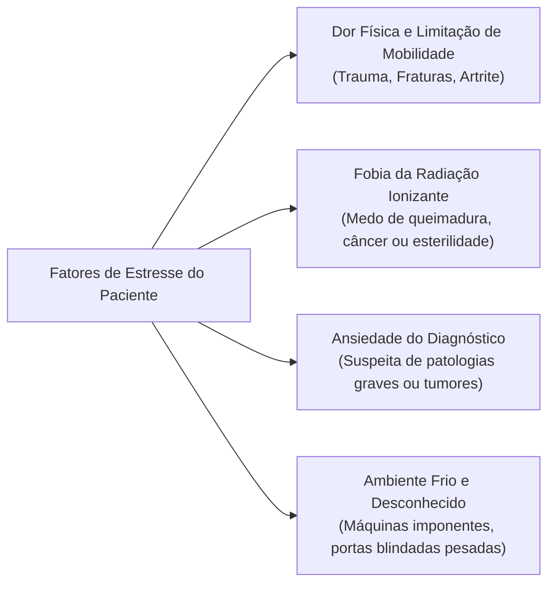
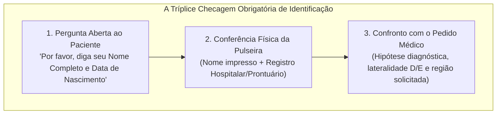
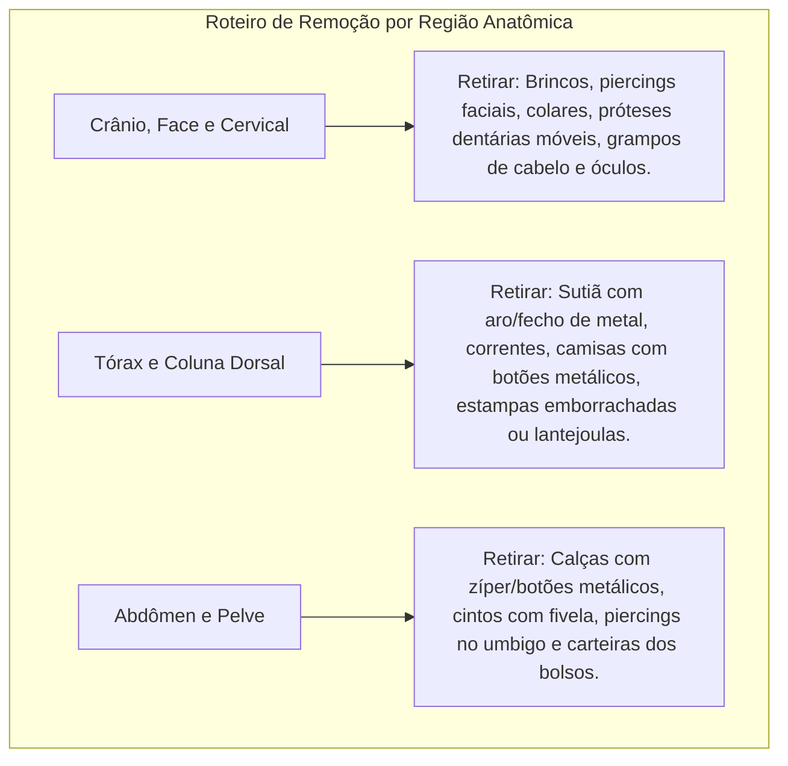
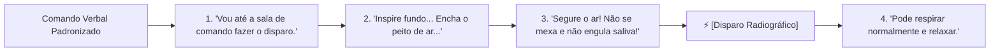

A excelência de um serviço de radiologia e diagnóstico por imagem não é medida apenas pela resolução espacial dos detectores digitais ou pela precisão milimétrica do feixe de radiação. O ponto de partida de qualquer procedimento bem-sucedido reside na **interação humana** entre o profissional das técnicas radiológicas e o paciente.

Na **aula do dia 29 de maio de 2026 da UC1** no Senac Campinas, estruturamos os pilares da **Comunicação Terapêutica, Segurança do Paciente, Protocolos de Identificação Inequívoca e Ética Profissional** no ambiente hospitalar e ambulatorial.

---

## 🎯 1. O Cenário Psicoemocional do Paciente no Radiodiagnóstico

Ao entrar em uma sala de raios X, o paciente frequentemente encontra-se em um estado de intensa vulnerabilidade física e emocional:

### O Papel Terapêutico do Técnico:
* **Escuta Ativa**: Ouvir as queixas do paciente com atenção, sem interromper ou demonstrar pressa.
* **Comunicação Clara e Não Técnica**: Substituir termos como *"decúbito dorsal em rotação medial"* por *"o senhor pode deitar de barriga para cima e girar ligeiramente a ponta dos pés para dentro?"*.
* **Desmistificação da Radiação**: Esclarecer com serenidade que o exame é rápido, indolor e realizado sob os mais rigorosos parâmetros de radioproteção (Princípio ALARA).

---

## 🛡️ 2. Meta Internacional de Segurança nº 1: O Protocolo dos Dois Identificadores

Erros de identificação de paciente estão entre os eventos adversos mais graves e evitáveis na área da saúde. Trocar o paciente ou realizar o exame no segmento anatômico errado pode acarretar condutas cirúrgicas desastrosas e irradiação desnecessária.

### ⚠️ As Regras de Ouro da Identificação:
1. **Nunca faça perguntas indutivas**:
   * ❌ *Incorreto*: *"O senhor é o José da Silva?"* (O paciente idoso ou confuso pode responder "sim" por reflexo).
   * ✅ *Correto*: *"Por favor, confirme seu nome completo e o dia, mês e ano do seu nascimento."*
2. **Nunca identifique por leito ou número de quarto**: Pacientes trocam de leito constantemente na enfermaria.
3. **Checagem de Lateralidade**: Se o pedido indica *"RX Joelho E"*, confirme verbalmente com o paciente: *"Qual dos joelhos está doendo ou sofreu a pancada?"*. Havendo divergência entre a queixa do paciente e o pedido médico, **nunca realize o exame sem antes checar com o médico assistente ou a equipe de enfermagem**.

---

## 📋 3. Anamnese Radiológica Dirigida e Triagem de Gestação

A **anamnese dirigida** é uma entrevista rápida e focada realizada pelo técnico antes do posicionamento. Ela guia a técnica radiográfica e orienta o médico radiologista na elaboração do laudo.

| Item da Anamnese | Pergunta Investigativa | Impacto Técnico e Diagnóstico |
| :--- | :--- | :--- |
| **Mecanismo do Trauma** | *"Como aconteceu a lesão? Foi queda, torção ou impacto direto?"* | Direciona a busca por fraturas específicas (ex: fratura em espiral por torção vs fratura transversa por impacto). |
| **Tempo de Evolução** | *"Essa dor começou hoje ou já faz semanas/meses?"* | Distingue processos agudos (edema/fratura recente) de patologias crônicas (artrose, osteófitos). |
| **Cirurgias Prévias e Implantes** | *"O senhor tem prótese metálica, pinos, placas ou marca-passo?"* | Alerta sobre a densidade metálica no campo e necessidade de compensação de kilovoltagem ($kV$). |
| **Triagem de Gestação** | *"Existe alguma possibilidade de gravidez? Qual a data da última menstruação?"* | **Crítico**: Proteção fetal imediata contra efeitos determinísticos e estocásticos da radiação. |

### 🤰 Protocolo Rígido de Proteção à Gestante:
* **Mulheres em idade fértil (12 a 50 anos)**: Deve-se questionar ativamente a data da última menstruação (**Regra dos 10 dias** do ciclo menstrual).
* **Havendo suspeita de gravidez**: O exame deve ser suspenso e discutido com o médico solicitante para avaliar substituição por ultrassonografia ou ressonância magnética.
* **Exame estritamente necessário e justificado**: Utilizar avental plumbífero duplo sobre a pelve/abdômen e aplicar colimação ultrarreduzida.

---

## 💍 4. Remoção de Adornos e Prevenção de Artefatos

Objetos radiopacos sobrepostos à imagem simulam lesões, mascaram fraturas e obrigam repetições injustificáveis de exames.

> 💡 **Privacidade e Respeito**: Ao solicitar a troca de roupa por avental hospitalar descartável, ofereça um ambiente privativo (vestiário), explique o motivo da troca e forneça um avental limpo e com amarração adequada para preservar a dignidade do paciente.

---

## 🗣️ 5. Orientações Claras de Exame e Comandos de Apneia

Durante o disparo, o paciente deve permanecer perfeitamente imóvel para evitar o **borramento cinético (artefato de movimento)**. O sucesso depende da clareza dos comandos de voz:

### Boas Práticas de Comunicação Verbal:
* Fale em tom calmo, firme e audível através do intercomunicador ou visor de vidro plumbífero.
* Treine o paciente uma vez antes de realizar o disparo real, especialmente idosos e crianças.
* Avise que a máquina emitirá um sinal sonoro (*beep*) e que isso é perfeitamente normal.

---

## ⚖️ 6. Ética Profissional e o Código de Ética do CONTER

O **Código de Ética dos Profissionais das Técnicas Radiológicas** (Resolução CONTER nº 15/2011) estabelece deveres intransponíveis para a conduta diária:

1. **Sigilo Profissional Absoluto**:
   * É terminantemente proibido comentar casos clínicos, patologias ou laudos de pacientes com terceiros ou em redes sociais (infração ética grave e violação da LGPD).
2. **Proibição de Emissão de Laudos ou Diagnósticos**:
   * O técnico **nunca deve emitir opinião diagnóstica para o paciente ou familiares** (ex: *"Aqui tem uma fratura bem feia"* ou *"Seu pulmão parece limpo"*). A emissão de laudo e o esclarecimento diagnóstico são competências privativas do médico radiologista.
   * *Resposta ética padrão*: *"O exame foi realizado com excelente qualidade técnica e agora será encaminhado para a análise minuciosa do médico radiologista, que emitirá o laudo oficial."*
3. **Respeito à Diversidade e Não Discriminação**: Atendimento equânime e digno a todo cidadão, independentemente de etnia, gênero, orientação sexual, classe social ou religião.

---

## 💡 Conclusão

A técnica radiográfica perfeita e o cálculo matemático exato de dose perdem o sentido se o atendimento for desumano, descuidado ou inseguro. Dominar a **comunicação terapêutica**, cumprir rigorosamente o **protocolo dos dois identificadores** e agir sob os preceitos do **Código de Ética do CONTER** é o que distingue o operador de máquina do **verdadeiro profissional da saúde**.
