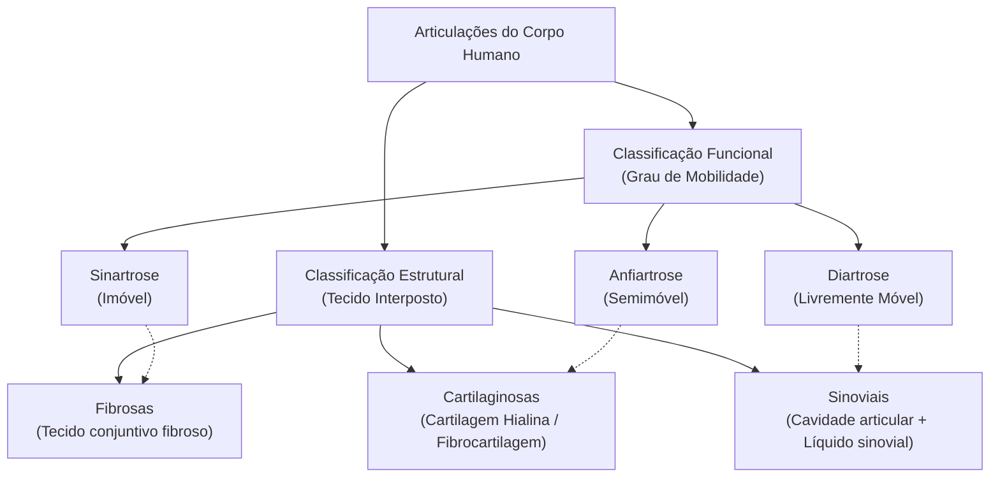
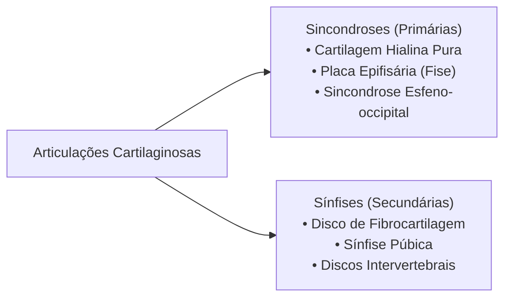
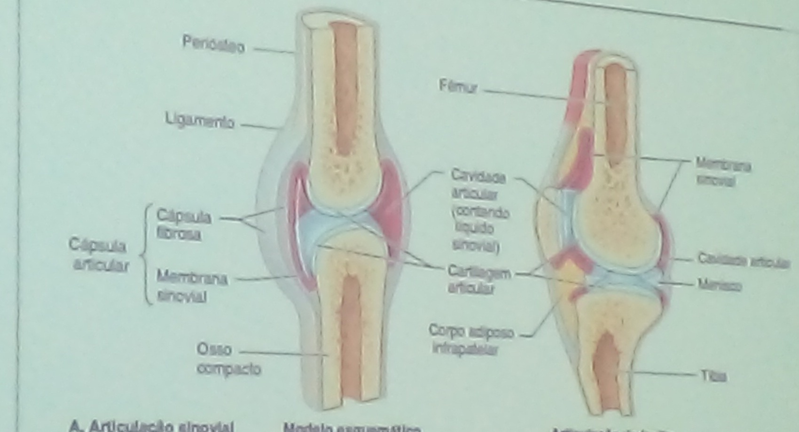
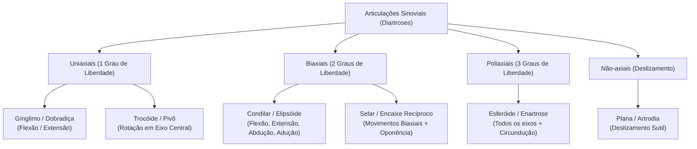

Na prática do diagnóstico por imagem, o técnico em radiologia não radiografa apenas estruturas ósseas rígidas e isoladas; ele documenta, fundamentalmente, as **unidades funcionais articulares**. Nas aulas práticas e teóricas da Unidade Curricular 2 (**UC2 — Realizar exames radiológicos em membros inferiores e membros superiores**) no laboratório do Senac, a transição entre o estudo puramente osteológico e a execução dos exames de extremidades exige um domínio sólido da **Artrologia** e da **Biomecânica**.

Compreender a morfologia e a dinâmica de cada tipo de juntura é a competência que separa o operador que "apenas aperta botões" do profissional de radiologia altamente capacitado. É esse conhecimento que determina a angulação milimétrica do Raio Central ($RC$) para abrir um espaço articular sem distorções, identifica os sinais indiretos cruciais de um derrame articular traumático e previne erros comuns de posicionamento que podem mascarar subluxações, artroses e fraturas periarticulares.

---

## 🦴 1. O Conceito de Articulação e a Relevância para o Exame Radiográfico

Anatomicamente, uma **articulação** (ou juntura) é definida como o ponto de união ou contato entre dois ou mais ossos, ou entre osso e cartilagem. No entanto, do ponto de vista da física da imagem radiológica:

> **O Paradoxo Radiológico do Espaço Articular:** A cartilagem hialina que recobre as superfícies ósseas e o líquido sinovial que preenche a cavidade articular são compostos predominantemente por água, proteoglicanos e colágeno. Apresentam densidade de partes moles e número atômico efetivo similar ao da água ($Z \approx 7{,}4$), sendo muito inferiores ao do fosfato de cálcio ósseo hidroxiapatita ($Z \approx 13{,}8$). Portanto, aos raios X convencionais, a cartilagem é **radiotransparente**. O que observamos no filme ou monitor digital como uma fenda radiotransparente entre dois ossos — o chamado **"espaço articular"** — é, na realidade, a soma da espessura das cartilagens articulares em contato.

Qualquer alteração nesse espaço óptico reflete processos patológicos graves:
* **Redução/Pinçamento articular:** Degeneração, atrito e perda progressiva de cartilagem (osteoartrite/artrose).
* **Alargamento articular:** Subluxação ligamentar, diástase traumática ou acúmulo sob pressão de fluidos (derrame articular volumoso).
* **Ausência do espaço com ponte óssea:** Anquilose fibrosa ou óssea pós-infecciosa/reumatológica.

---

## ⚙️ 2. Classificação Geral das Articulações: Critério Funcional vs. Estrutural

A anatomia clássica e funcional classifica as articulações através de dois pilares complementares: o **grau de mobilidade** (critério fisiológico/funcional) e o **tecido conjuntivo de união interposto** (critério morfológico/estrutural).

### 2.1. Classificação Funcional (Cinesiologia)

1. **Sinartroses (Imóveis):** Não oferecem mobilidade apreciável em condições fisiológicas do adulto. Têm como função primária a proteção de estruturas nobres vitais e estabilidade esquelética (ex: ossos da calvária craniana).
2. **Anfiartroses (Semimóveis):** Apresentam mobilidade discreta e limitada, atuando primordialmente como amortecedores elásticos de carga, distribuição de peso e absorção de choques axiais (ex: sínfise púbica e discos intervertebrais).
3. **Diartroses (Móveis):** Caracterizam-se por grande amplitude de movimento cinesiológico nos mais variados eixos espaciais, sendo o foco da maioria das rotinas radiográficas de extremidades (MMSS e MMII).

---

## 🔍 3. As Três Classes Estruturais e suas Implicações na Rotina do Técnico

### 3.1. Articulações Fibrosas (Sinartroses Estruturais)

Nessas articulações, os ossos mantêm união direta por meio de feixes colágenos de tecido conjuntivo fibroso denso, sem presença de cavidade articular. Dividem-se em:

#### A. Suturas
Encontradas exclusivamente no crânio. Conforme a osteologia craniana, as margens ósseas dentadas ou serrilhadas se interdigitam firmemente:
* **Sutura Coronal:** Entre o osso frontal e os parietais.
* **Sutura Sagital:** Entre os dois ossos parietais ao longo da linha mediana sagital.
* **Sutura Lambdóidea:** Entre os ossos parietais e o osso occipital.
* **Sutura Escamosa:** Entre a escama do osso temporal e o parietal.

> 💡 **Atenção Pediátrica:** No recém-nascido e lactente, as suturas ainda não completaram sua união fibrosa madura, deixando amplas áreas membranosas conhecidas como **fontículos (fontanelas)** — notadamente o fontículo anterior (bregmático) e posterior (lambdático). Em radiografias pediátricas do crânio, essas áreas surgem amplamente radiotransparentes e jamais devem ser confundidas com fraturas cominutivas ou diástases patológicas. O fechamento prematuro patológico dessas suturas é a condição clínica denominada **craniossinostose**.

#### B. Sindesmoses
Articulações nas quais duas superfícies ósseas afastadas são unidas por ligamentos densos ou por uma membrana interóssea flexível:
* **Sindesmose Tíbio-Fibular Distal:** União ligamentar crucial entre a incisura fibular da tíbia e a extremidade distal da fíbula.
* **Membranas Interósseas do Antebraço e da Perna:** Unem as diáfises do rádio/ulna e da tíbia/fíbula.

> ⚠️ **Relevância no Trauma de Tornozelo:** Na incidência radiográfica mortise (oblíqua medial a 15°-20° do tornozelo), o técnico precisa avaliar criteriosamente o espaço claro tíbio-fibular ($< 6\text{ mm}$). Um alargamento desse espaço indica **diástase da sindesmose** por ruptura ligamentar (lesão de alto impacto, frequentemente associada à fratura proximal de fíbula — *Fratura de Maisonneuve*).

#### C. Gonfoses (Sindesmoses Dentoalveolares)
Articulação especializada em que a raiz cônica do dente é cimentada no interior do alvéolo dentário da mandíbula ou maxila pelo ligamento periodontal. É objeto constante de estudo nas radiografias panorâmicas ortopantomográficas e exames periapicais.

---

### 3.2. Articulações Cartilaginosas (Cartilagíneas / Anfiartroses)

Os ossos conectam-se por tecido cartilaginoso contínuo, sem cavidade sinovial. Dividem-se em dois subgrupos histológicos fundamentais:

#### A. Sincondroses (Articulações Cartilagíneas Primárias)
Unidas por cartilagem hialina pura. A maioria possui caráter transitório durante o desenvolvimento esquelético:
* **Placa Epifisária de Crescimento (Fise de Crescimento):** Separa a epífise da metáfise dos ossos longos até a consolidação óssea total ao final da adolescência. No estudo de **Idade Óssea (Greulich & Pyle)** e em radiografias de extremidades pediátricas, a visualização nítida dessa faixa radiotransparente é o balizador central de maturidade esquelética.

#### B. Sínfises (Articulações Cartilagíneas Secundárias)
As superfícies articulares ósseas são recobertas por uma delgada camada de cartilagem hialina e conectadas firmemente por um bloco volumoso e fibroelástico de **fibrocartilagem**:
* **Sínfise Púbica:** Localizada na união anterior dos dois ossos do quadril. Suporta imensa tensão de cisalhamento durante a marcha e adapta-se na gestação sob influxo do hormônio relaxina.
* **Articulações Intervertebrais (Discos Intervertebrais):** Dispostos entre os corpos vertebrais adjacentes do espaço $C2\text{--}C3$ até $L5\text{--}S1$ (lembrando que não existe disco entre $C1$ e $C2$, pois o Atlas é desprovido de corpo vertebral). Cada disco consiste em um **anel fibroso** periférico (camadas concêntricas de fibrocartilagem resistente) e um **núcleo pulposo** central (massa gelatinosa rica em água e glicosaminoglicanos que atua como pistão hidráulico amortecedor).

> 🚨 **Correlação Clínica — Degeneração Discal e Hérnia de Disco:** Conforme demonstrado nas aulas práticas de anatomia e radiologia da coluna, o envelhecimento e o trauma mecânico causam desidratação do núcleo pulposo e fissuras concêntricas no anel fibroso. No exame radiográfico da coluna (AP e Perfil), a repercussão visual direta é o **pinçamento do espaço intervertebral**, associado à esclerose óssea reativa nos platôs vertebrais e osteófitos marginais (*"bicos de papagaio"*). Caso o anel rompa completamente, ocorre a **extrusão discal (hérnia de disco)** posterolateral em direção ao canal vertebral e forames de conjugação, comprimindo raízes nervosas. Embora a hérnia discal direta de partes moles exija **Ressonância Magnética (RM)** para caracterização tecidual, a radiografia convencional permanece como triagem biomecânica de primeira linha.

---

### 3.3. Articulações Sinoviais (Diartroses) — A Engenharia das Extremidades

As articulações sinoviais representam o ápice da especialização motora no corpo humano. São as junturas móveis presentes em praticamente todos os segmentos de membros superiores e inferiores estudados na UC2.

*Figura 1: Esquema de uma articulação sinovial típica (esquerda) e corte longitudinal da articulação femorotibial do joelho (direita), ilustrando a disposição da cápsula articular, membrana sinovial, cavidade articular, cartilagem hialina articular e fibrocartilagens estabilizadoras (meniscos).*

#### Elementos Anatômicos Obrigatórios da Articulação Sinovial:

1. **Cápsula Articular:** Envoltório resistente composto por duas camadas distintas:
   * *Camada Fibrosa Externa:* Tecido conjuntivo colágeno denso contínuo com o periósteo dos ossos adjacentes. Oferece contenção mecânica estrutural e resistência a forças trativas externas.
   * *Membrana Sinovial Interna:* Camada delicada de tecido conjuntivo frouxo altamente vascularizado e inervado. Contém sinoviócitos especializados responsáveis pela produção e secreção do **líquido sinovial**.
2. **Cavidade Articular:** Espaço real (embora fisiologicamente capilar/virtual) delimitado pela membrana sinovial e pelas superfícies cartilaginosas, contendo uma fina película lubrificante.
3. **Líquido Sinovial:** Fluido viscoso derivado do plasma sanguíneo enriquecido com ácido hialurônico e proteoglicanos. Funções centrais:
   * Lubrificação das superfícies em movimento, reduzindo o coeficiente de fricção ($\mu \approx 0{,}001$).
   * Nutrição metabólica e oxigenação das células cartilaginosas (condrócitos), visto que a cartilagem articular adulta é totalmente avascular.
   * Remoção de resíduos metabólicos celulares através da circulação sinovial.
4. **Cartilagem Articular Hialina:** Capa resiliente e lisa (1 a 7 mm de espessura) que recobre as superfícies ósseas de contato. Amortece impactos compressivos extraordinários e desliza quase sem atrito.
5. **Estruturas Acessórias e Fibrocartilagens Intra-articulares:**
   * *Meniscos (Joelho):* Discos semilunares de fibrocartilagem (medial em formato de "C" e lateral em "O") que aumentam a congruência entre os côndilos femorais arredondados e os platôs tibiais planos, distribuindo as cargas axiais.
   * *Lábios/Labrum (Ombro e Quadril):* Anéis fibrocartilaginosos que aprofundam as cavidades receptórias (cavidade glenoide e acetábulo), prevenindo luxações mecânicas.
   * *Bolsas Sinoviais (Bursas) e Bainhas Tendíneas:* Sacos repletos de líquido sinovial interpostos em pontos de atrito entre tendões, ligamentos e proeminências ósseas.

---

## 🎯 4. Os 6 Tipos Morfofuncionais de Articulações Sinoviais

A biomecânica radiológica classifica as articulações sinoviais conforme o formato geométrico das superfícies ósseas em contato e a quantidade de **eixos cinesiológicos** de movimento permitidos (Uniaxial, Biaxial e Poliaxial/Triaxial):

### Detalhamento Morfofuncional e Correlações Técnicas:

| Tipo Morfológico | Eixos / Graus | Superfícies Anatômicas de Encaixe | Movimentos Permitidos | Exemplos Anatômicos (UC2) | Relevância no Posicionamento Radiográfico |
| :--- | :---: | :--- | :--- | :--- | :--- |
| **Gínglimo** *(Dobradiça)* | **Uniaxial** *(1 eixo transversal)* | Superfície convexa cilíndrica articulando-se em uma concavidade em calha. | Flexão e Extensão. | Articulação úmero-ulnar (Cotovelo), Articulações Interfalângicas da mão e do pé. | Exige alinhamento ortogonal rigoroso no perfil a 90°. Qualquer obliquidade fecha o espaço gínglimo no filme. |
| **Trocóide** *(Pivô)* | **Uniaxial** *(1 eixo longitudinal)* | Processo ósseo arredondado/cônico girando dentro de um anel osteofibroso. | Rotação (Medial e Lateral / Supinação e Pronação). | Articulação Rádio-Ulnar Proximal e Distal; Articulação Atlantoaxial Mediana ($C1\text{--}C2$, dente do áxis). | No antebraço, a pronação cruza o rádio sobre a ulna; por isso o AP exige **mão supinada**. |
| **Condilar** *(Elipsóide)* | **Biaxial** *(2 eixos ortogonais)* | Côndilo oval convexo alojando-se em uma cavidade elíptica côncava receptora. | Flexão, Extensão, Abdução, Adução e Circundução restrita. | Articulação Radiocárpica (Punho), Metacarpofalângicas (2º ao 5º dedos), Articulação Femorotibial (Bicondilar do Joelho). | No punho e joelho, desvios e inclinações do feixe abrem seletivamente o espaço condilar sem sobreposição de margens. |
| **Selar** *(Encaixe Recíproco)* | **Biaxial** *(2 eixos mutuamente côncavos e convexos)* | Superfície em formato de sela de montaria encaixada reciprocamente na outra. | Flexão, Extensão, Abdução, Adução e Oponência. | Articulação Carpometacárpica do Polegar (Trapézio-1º MC); Articulação Esternoclavicular. | Base da preensão humana. Incidência de Robert (AP verdadeiro do polegar) e rotinas de estresse. |
| **Esferóide** *(Enartrose)* | **Poliaxial** *(3 eixos espaciais)* | Cabeça esférica convexa articulando-se em receptáculo esferoidal côncavo. | Todos os movimentos: Flexão, Extensão, Abdução, Adução, Rotações e Circundução ampla. | Articulação Glenoumeral (Ombro) e Articulação Coxofemoral (Quadril). | Máxima mobilidade e menor estabilidade óssea intrínseca. Propenso a luxações (luxação glenoumeral anterior/posterior). |
| **Plana** *(Artrodia)* | **Não-axial** *(Sem eixo angular)* | Superfícies ósseas praticamente planas ou ligeiramente curvas. | Deslizamento sutil entre as faces articulares. | Articulações Intercárpicas, Intertársicas (Chopart e Lisfranc), Acromioclavicular. | Avaliadas em incidências oblíquas específicas a 30°-45° para dissociar os ossos do carpo e tarso. |

---

## 📈 5. Biomecânica da Imagem: Sinais Radiológicos Articulares Fundamentais

### 5.1. O Sinal do Derrame Articular e os Coxins Gordurosos (*Fat Pad Signs*)
Em condições de normalidade, a cavidade sinovial contém menos de $3\text{ a }5\text{ mL}$ de líquido sinovial fisiológico em grandes articulações como o joelho. No entanto, em episódios inflamatórios (artrite), infecciosos (artrite séptica) ou traumáticos com ruptura óssea ou ligamentar (**hemartrose**), o volume de líquido expande bruscamente:

* **Sinal da Vela / Coxim Gorduroso no Cotovelo:** Na incidência em perfil estrito a 90° do cotovelo, a distensão da cápsula pelo derrame empurra as camadas de gordura periarticular normais para fora da fossa do olécrano e da fossa coronoide. O coxim gorduroso posterior (normalmente invisível no perfil) torna-se visível como uma linha radiotransparente convexa projetada posteriormente. O coxim anterior eleva-se, lembrando a vela desfraldada de um barco (*sail sign*). Para a equipe médica, esse sinal indireto em crianças com trauma recente sugere fortemente uma **fratura supracondiliana oculta do úmero**, enquanto no adulto é o sinal cardinal clássico de uma **fratura oculta da cabeça do rádio**.
* **Derrame no Joelho:** Na radiografia em perfil com feixe horizontal (*cross-table*), é possível demonstrar o nível líquido-gordura (**lipo-hemartrose**), onde a gordura medular extravasada de uma fratura intra-articular do fêmur ou tíbia flutua sobre a camada de sangue mais denso no recesso suprapatelar.

### 5.2. A Degeneração Articular: Da Cartilagem ao Osso Subcondral (Artrose)
A radiografia simples é o padrão-ouro de baixo custo para estadiamento de **osteoartrose**:

1. **Pinçamento do Espaço Articular:** Redução da fenda radiotransparente, frequentemente assimétrica no compartimento mais sobrecarregado (ex: compartimento medial do joelho no joelho varo).
2. **Esclerose Óssea Subcondral:** Com a perda da cartilagem hialina amortecedora, as forças de pressão mecânica atuam diretamente sobre o osso trabecular subjacente. Em resposta fisiopatológica, o osso se remodela aumentando sua massa por unidade de volume, tornando-se mais radiopaco (esbranquiçado) no filme:
   $$\mu_{\text{esclerose}} > \mu_{\text{osso normal}}$$
3. **Osteófitos Marginais:** Proliferações osteocartilaginosas que surgem nas bordas articulares como tentativa biológica do organismo de aumentar a área de superfície de contato para dissipar o peso excessivo.
4. **Geodos / Cistos Subcondrais:** Pequenas lesões radiotransparentes intra-ósseas causadas por microfraturas trabeculares e infiltração sob pressão do líquido sinovial através do osso subcondral denudado.

---

## 📐 6. Princípios Operacionais e de Qualidade para o Técnico no Laboratório

Para que uma articulação seja corretamente diagnosticada na radiografia convencional, o operador precisa aplicar princípios geométricos estritos:

### 1. Tangência e Perpendicularidade do Raio Central ($RC$)
O feixe primário de raios X deve penetrar **rigorosamente paralelo** às superfícies articulares e perpendicular ao receptor de imagem. Se o feixe estiver angulado em relação à fenda articular, a borda óssea anterior ou posterior se sobrepõe ao espaço articular, forjando um falso diagnóstico de pinçamento:
* No **AP de Pé**, o feixe deve ter **$10^\circ$ de inclinação posterior (em direção ao calcanhar)** — incidindo na base do terceiro metatarso — para coincidir exatamente com a curvatura anatômica do arco plantar e abrir os espaços articulares tarsometatársicos (Linha de Lisfranc).
* No **AP de Joelho**, a angulação do raio central depende da **distância da EIAS (espinha ilíaca ântero-superior) ao tampo da mesa** para alinhar o feixe paralelamente ao platô tibial: pacientes com pelve rasa ($< 19\text{ cm}$) exigem $3^\circ \text{ a } 5^\circ$ caudal (podálico); pacientes médios ($19 \text{ a } 24\text{ cm}$) utilizam feixe perpendicular ($0^\circ$); e pacientes com pelve espessa ($> 24\text{ cm}$) demandam $3^\circ \text{ a } 5^\circ$ cefálico.

### 2. A Regra de Ouro da Ortopedia: Duas Projeções Ortogonais a 90°
Uma única projeção radiográfica jamais é suficiente para avaliar a estabilidade articular. Como o exame é a projeção bidimensional de uma estrutura tridimensional, uma luxação ou desalinhamento articular pode passar despercebida no AP se o osso deslocar-se estritamente no plano ântero-posterior, revelando-se de forma gritante apenas no Perfil ortogonal.

### 3. Fatores de Exposição e Princípio ALARA
O ajuste correto da técnica radiográfica ($kV$ e $mAs$) em estudos articulares requer penetração suficiente para delinear o trabeculado e as corticais ósseas, mantendo latitude para identificar os coxins gordurosos e os planos de partes moles circundantes:

$$kV = 2e + C$$

Onde $e$ é a espessura em centímetros aferida com espessômetro articular e $C$ a constante do aparelho. A colimação estrita sobre a articulação estudada é obrigatória: reduz a radiação espalhada (efeito Compton), aprimora o contraste articular e poupa a dose do paciente conforme as diretrizes da **RDC ANVISA nº 611/2022** e da norma **CNEN NN 3.01**.

---

## 🎯 Síntese e Conclusão

O estudo da Artrologia na UC2 fecha o ciclo de fundamentação anatômica das extremidades. Ao compreender que o espaço radiotransparente entre os ossos é uma sofisticada estrutura de cartilagem hialina lubrificada por líquido sinovial e contida por ligamentos, o técnico adquire a percepção clínica necessária para executar cada posicionamento com rigor milimétrico.

Nas próximas aulas e postagens, aplicaremos diretamente essa mecânica articular nas primeiras rotinas de membros inferiores: o estudo radiográfico do **Antepé, Pododáctilos e as complexas linhas de articulação de Lisfranc e Chopart**.

