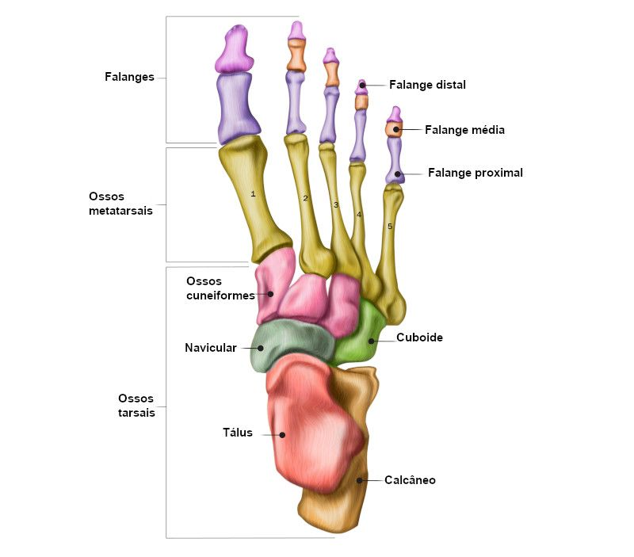
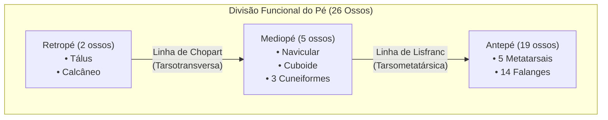
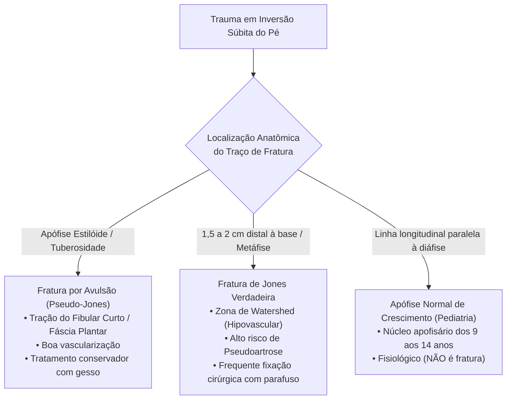

O estudo dos membros inferiores no diagnóstico por imagem tem início pela estrutura que sustenta e absorve todo o impacto da locomoção humana: o **pé**. Nas aulas teóricas e práticas da **UC2 (Realizar exames radiológicos em membros inferiores e membros superiores)** no laboratório do Senac, as rotinas radiográficas do **Pé** representam um dos cenários de maior prevalência em prontos-socorros ortopédicos e clínicas de trauma.

Desde traumas diretos até entorses esportivas com arrancamento ósseo por tração tendínea, o técnico em radiologia precisa dominar a anatomia funcional do pé e a física geométrica do feixe de raios X. Um pequeno erro de $5^\circ$ na inclinação do tubo ou um posicionamento frouxo da face plantar pode sobrepor articulações críticas e ocultar lesões de altíssima gravidade funcional — como as **luxações da Linha de Lisfranc** e as temidas **fraturas de Jones** na base do 5º metatarso.

---

## 🦴 1. Arquitetura Osteoarticular do Pé Humano

O esqueleto de cada pé é composto por **26 ossos constantes** (além de ossos sesamoides constantes sob a cabeça do 1º metatarso), interligados por uma densa rede ligamentar e tendínea:

*Figura 1: Mapeamento anatômico do pé direito em vista dorsal. Diferenciação cromática entre as 14 falanges (antepé distal), os 5 ossos metatarsais (antepé proximal) e os 7 ossos tarsais (cuneiformes medial, intermédio e lateral, cuboide, navicular, tálus e calcâneo).*

### 1.1. As Três Unidades Morfofuncionais do Pé

1. **Antepé:** Composto pelos 5 ossos metatarsais e pelas 14 falanges. Responsável pelo impulso final da passada na marcha (*push-off*) e pela distribuição do peso anterior.
2. **Mediopé:** Composto pelos 3 ossos cuneiformes (medial, intermédio e lateral), pelo osso navicular (medialmente) e pelo osso cuboide (lateralmente). Atua como a chave de abóbada dos arcos plantares longitudinal e transverso.
3. **Retropé:** Composto pelo tálus (que recebe a tíbia e a fíbula na articulação do tornozelo) e pelo calcâneo (maior osso do pé, formando o calcanhar). Conduz as forças de impacto inicial do calcanhar com o solo.

---

## 📍 2. Linhas Cirúrgicas e Articulares Estratégicas: Lisfranc vs. Chopart

No ambiente de urgência ortopédica, o técnico em radiologia ouvirá constantemente os termos **"Linha de Lisfranc"** e **"Linha de Chopart"**. Não se tratam de acidentes ósseos individuais, mas sim de complexos articulares transversos de vital importância cinesiológica e cirúrgica:

### 2.1. Linha de Lisfranc (Articulação Tarsometatársica — TMT)
* **Definição:** É a articulação anatômica que separa o **Mediopé** do **Antepé**. Conecta as bases dos 5 metatarsais aos três cuneiformes e ao cuboide.
* **A Chave de Abóbada Mecânica:** A base do **2º metatarso** é mais longa e recuada proximalmente, ficando "encaixada" em uma mortise óssea formada pelo cuneiforme medial, cuneiforme intermédio e cuneiforme lateral. Isso confere rigidez intrínseca ao arco transverso.
* **O Ligamento de Lisfranc:** Conecta a face plantar do cuneiforme medial à face medial da base do 2º metatarso. **Atenção:** não existe ligamento conectando as bases do 1º e do 2º metatarso; toda a estabilidade transversal depende do ligamento de Lisfranc!
* **A Avaliação Radiológica no AP de Pé:**
  > 📐 **Critério de Alinhamento de Lisfranc:** Na radiografia em projeção AP, a **borda medial da base do 2º metatarso** deve estar em alinhamento anatômico rigoroso e perfeitamente contínuo com a **borda medial do cuneiforme intermédio (2º cuneiforme)**. Na incidência oblíqua a 30°, a borda medial do 3º metatarso deve alinhar com o 3º cuneiforme, e a borda medial do 4º metatarso com o cuboide. Um desvio ou diástase superior a $2\text{ mm}$ indica **Fratura-Luxação de Lisfranc** — emergência cirúrgica que, se não identificada, resulta em colapso do arco plantar e dor crônica incapacitante.

### 2.2. Linha de Chopart (Articulação Transversa do Tarso / Médio-Társica)
* **Definição:** Separa o **Retropé** (tálus e calcâneo) do **Mediopé** (navicular e cuboide).
* **Composição:** Formada pela junção contínua de duas articulações em formato aproximado de "S" itálico:
  1. *Articulação Talonavicular* (medial).
  2. *Articulação Calcaneocuboidea* (lateral).
* **Relevância Clínica:** É a articulação responsável pelos movimentos dinâmicos de inversão e eversão do pé no solo. Historicamente famosa nas amputações de antepé em traumatologia militar (amputação de Chopart), hoje é avaliada no trauma de alta energia para detecção de fraturas-luxações do tarso.

---

## ⚡ 3. O Ponto Crítico do 5º Metatarso: Fratura de Jones vs. Fratura por Avulsão

Durante a análise dos slides e da anatomia prática no laboratório do Senac, uma estrutura se sobressai como campeã de pedidos de exames radiográficos: a **tuberosidade da base do 5º metatarso**.

O 5º metatarso é subdividido em:
1. Cabeça (distal)
2. Colo
3. Corpo / Diáfise
4. Base com a proeminente **Tuberosidade Lateral**

### O Diagnóstico Diferencial Radiográfico:
* **Fratura por Avulsão (Pseudo-Jones / Fratura do Dançarino):** Arrancamento da ponta da tuberosidade do 5º MTT resultante da contração reflexa violenta do tendão do músculo fibular curto ou da banda lateral da fáscia plantar durante uma entorse brusca com inversão e flexão plantar. O traço é extra-articular ou estende-se para a articulação cuboideometatarsal. Possui excelente irrigação sanguínea e consolida com imobilização gessada simples.
* **Fratura de Jones Verdadeira:** Ocorre na junção metafisária-diafisária proximal, a cerca de $1{,}5\text{ a }2{,}0\text{ cm}$ distalmente à ponta da tuberosidade. Essa região anatômica é uma **zona de transição vascular (watershed)**, com baixa densidade capilar. Por essa razão, a fratura de Jones apresenta índices alarmantes de **retardo de consolidação e pseudoartrose (não união óssea)**, exigindo frequentemente abordagem cirúrgica com parafuso intramedular em atletas e trabalhadores.
* **Armadilha Pediátrica:** Em pacientes na faixa etária entre 9 e 14 anos, o centro de ossificação apofisário da tuberosidade do 5º MTT surge como uma linha radiotransparente **longitudinal (paralela à diáfise)**. As fraturas, ao contrário, são **transversais ou oblíquas** (perpendiculares à cortical do osso). Dominar esse critério evita imobilizações desnecessárias em crianças!

---

## 📸 4. Protocolos e Rotinas Radiográficas de Pé

### 4.1. Rotina de Pé: Projeções AP e Oblíqua Medial

| Parâmetro Técnico | Incidência 1: AP de Pé (Dorsoplantar) | Incidência 2: Oblíqua Medial de Pé |
| :--- | :--- | :--- |
| **Receptor / Chassi** | $24 \times 30\text{ cm}$ longitudinal | $24 \times 30\text{ cm}$ longitudinal |
| **Grade Antidifusora** | **Sem grade** (exame no tampo da mesa) | **Sem grade** (tampo da mesa) |
| **Posicionamento do Paciente** | Decúbito dorsal ou sentado na mesa; joelho flexionado com a **face plantar apoiada uniformemente** sobre o detector. | A partir do AP, rotacionar o pé e a perna medialmente até a planta formar **$30^\circ\text{ a }40^\circ$** com o detector. |
| **Raio Central ($RC$)** | **Angulado $10^\circ$ posteriormente (em direção ao calcanhar)**, incidindo na **base do 3º metatarso**. | **Perpendicular** ao detector de imagem, incidindo na **base do 3º metatarso**. |
| **Distância Foco-Receptor ($DFR$)** | $100\text{ cm}$ | $100\text{ cm}$ |

#### Por que o AP de Pé exige angulação de 10° Posterior (em direção ao calcanhar)?
Muitos iniciantes erram ao incidir o raio perpendicularmente no AP de pé. O arco plantar longitudinal confere uma declividade natural às bases dos metatarsos em relação ao calcanhar. Uma inclinação de $10^\circ$ posterior (em direção ao calcanhar) faz com que o feixe de raios X penetre **rigorosamente paralelo** às articulações tarsometatársicas (Lisfranc) e metatarsofalângicas, abrindo os espaços articulares no filme e eliminando a distorção geométrica por ampliação das falanges distais.

#### O Segredo da Oblíqua Medial a 30°:
A rotação interna de $30^\circ$ projeta as articulações intertársicas livres de superposição:
* Abre a articulação entre o **cuboide** e o calcâneo/cuneiforme lateral.
* Abre os espaços intermetatársicos do 3º, 4º e 5º metatarsos.
* Demonstra a tuberosidade do 5º metatarso em projeção tangencial nítida, sendo a incidência definitiva para confirmação da fratura de Jones.

---

## 🛡️ 5. Proteção Radiológica e Parâmetros ALARA em Extremidades

Embora o exame de extremidades distais envolva uma dose efetiva muito reduzida em comparação ao tórax ou à coluna ($\approx 0{,}001\text{ mSv}$ por incidência), o respeito absoluto às diretrizes da **RDC ANVISA nº 611/2022** e da norma **CNEN NN 3.01** é o selo de responsabilidade do profissional:

1. **Colimação Quádrupla Estrita:** Ajustar as lâminas do colimador rigorosamente aos limites anatômicos do pé. A colimação reduz drasticamente a radiação espalhada por efeito Compton, o que não apenas protege a tireoide e as gônadas do paciente sentado à mesa, mas também **aumenta significativamente o contraste das trabéculas ósseas** na imagem final.
2. **Evitar Repetições por Falha de Instrução:** Explicar ao paciente em linguagem clara e acessível a importância de não mover o pé e a perna no momento do disparo. Cada repetição por artefato de movimento dobra desnecessariamente a dose do exame.

---

## 🎯 Conclusão e Próximos Passos

O domínio do exame radiográfico de pé nas projeções AP e Oblíqua estabelece o padrão de excelência na rotina ortopédica. Saber exatamente por que angular o tubo em $10^\circ$ no AP e como identificar o alinhamento da borda medial do 2º metatarso no complexo de Lisfranc transforma a precisão do exame e garante diagnósticos imediatos e seguros.

Na próxima etapa e publicação, avançaremos proximalmente pelo membro inferior: o estudo radiográfico do **Retropé (Calcâneo e Tálus) e da Articulação do Tornozelo**, explorando a incidência Axial de Calcâneo a $40^\circ$ e a projeção de Mortise.

