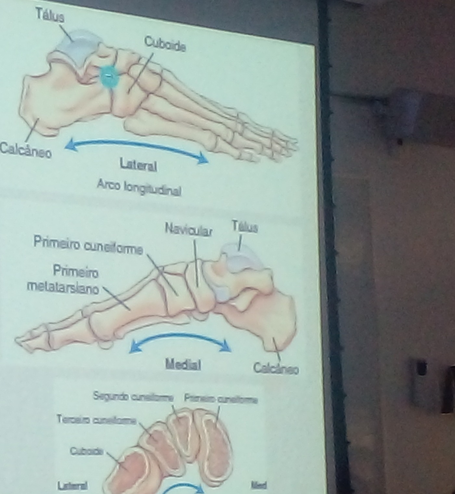
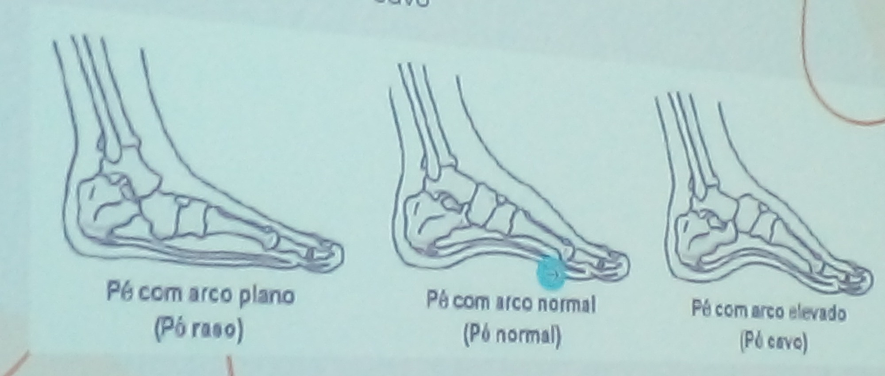
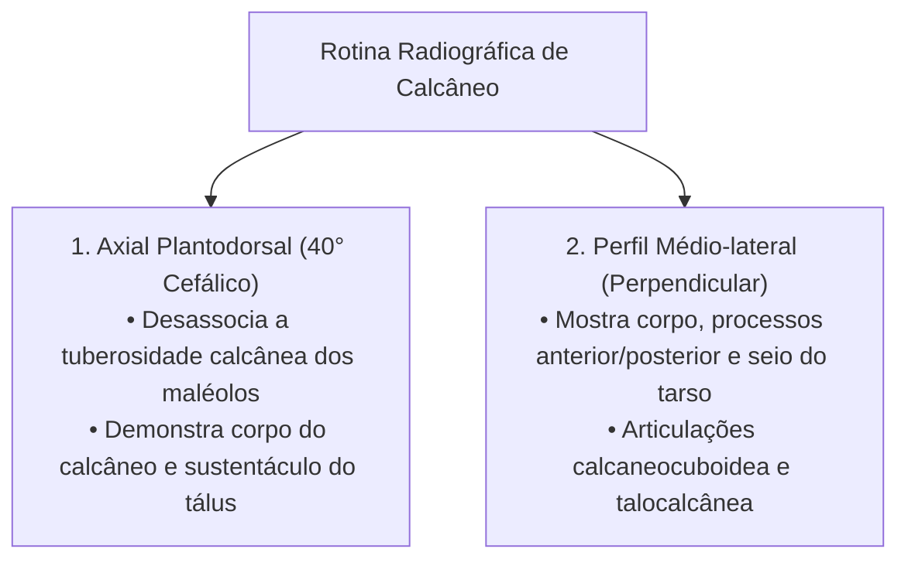

Dando continuidade ao aprendizado dos membros inferiores na **UC2 (Realizar exames radiológicos em membros inferiores e membros superiores)** no laboratório do Senac, progredimos do estudo do antepé para a região de suporte e distribuição das forças mecânicas do corpo humano: o **Retropé** e o complexo anatômico dos **Ossos do Tarso**, com foco operacional na **Rotina Radiográfica de Calcâneo**.

Em sala de aula e bancada de estudo anatômico, correlacionamos a estrutura óssea do tarso com a mecânica dos arcos plantares e os desafios práticos de posicionamento. Para o técnico em radiologia, a realização precisa da **Incidência Axial Plantodorsal com Raio Central a $40^\circ$ cefálico** e o alinhamento estrito do **Perfil Médio-lateral** são fundamentais para demonstrar a anatomia livre de distorções e sobreposições, garantindo imagens de alto valor técnico para a avaliação do médico radiologista.

---

## 🦴 1. Anatomia Osteoarticular do Retropé e Ossos do Tarso

O tarso é composto por sete ossos articulados entre si, organizados funcionalmente para suportar o peso e absorver impactos durante a locomoção:

*Figura 1: Representação biomecânica dos arcos plantares. Vista lateral do arco longitudinal lateral (calcâneo e cuboide), vista medial do arco longitudinal medial (calcâneo, tálus, navicular e cuneiformes) e corte transversal do arco transverso do tarso distal.*

### Divisão Funcional dos Ossos do Tarso:
1. **Retropé:**
   * **Calcâneo:** O maior osso do tarso, responsável pela sustentação posterior do pé e apoio no solo.
   * **Tálus:** Osso que recebe a carga transmitida pela tíbia e a redistribui entre o calcâneo e o mediopé.
2. **Mediopé:**
   * **Navicular:** Localizado na face medial do pé, interpõe-se entre a cabeça do tálus e os três cuneiformes.
   * **Cuboide:** Situado na face lateral do pé, articula-se proximalmente com o calcâneo e distalmente com o 4º e 5º metatarsais.
   * **Três Cuneiformes:** Medial (1º), Intermediário (2º) e Lateral (3º), que se articulam com o navicular proximalmente e com as bases dos três primeiros metatarsais distalmente.

---

## 🦴 2. O Calcâneo: Anatomia Descritiva e Acidentes Críticos

O calcâneo possui morfologia irregularmente retangular, destacando-se acidentes ósseos essenciais que orientam o posicionamento radiológico e a checagem da qualidade técnica:

* **Tuberosidade Posterior do Calcâneo:** Porção volumosa posterior que forma a proeminência do calcanhar e serve como ponto de inserção do tendão calcâneo (tendão de Aquiles).
* **Sustentáculo do Tálus (*Sustentaculum Tali*):** Proeminência óssea horizontal em forma de prateleira projetada medialmente. Suporta a faceta articular média para o tálus e serve como referência anatômica para confirmar se a incidência axial foi obtida sem rotação medial ou lateral excessiva.
* **Seio do Tarso (*Sinus Tarsi*):** Espaço afunilado escavado entre o sulco do calcâneo e o sulco do tálus na face súpero-lateral, visível em perfil quando não há rotação do membro.
* **Facetas Articulares Subtalares:** Três superfícies articulares (anterior, média e posterior) que se articulam com a face inferior do tálus formando a articulação talocalcânea.

---

## 📐 3. Biomecânica dos Arcos Plantares e Classificação Morfológica do Pé

Durante as atividades de desenho anatômico ilustrado desenvolvidas em grupo no laboratório, exploramos como os ossos do tarso e metatarsais organizam-se espacialmente em abóbadas elásticas:

*Figura 2: Classificação biomecânica do pé: pé com arco plano (pé chato/raso com rebaixamento do arco medial), pé com arco normal e pé com arco elevado (pé cavo).*

1. **Arco Longitudinal Medial:** O mais alto e elástico, composto por calcâneo, tálus, navicular, 3 cuneiformes e os 3 primeiros metatarsais.
2. **Arco Longitudinal Lateral:** Mais baixo e plano, formado por calcâneo, cuboide e o 4º e 5º metatarsais, atuando no suporte rígido de peso.
3. **Arco Transverso:** Dispõe-se na largura do pé ao nível dos ossos distais do tarso e bases dos metatarsais.

A identificação dessas estruturas no plano sagital e axial permite ao profissional de radiologia compreender como variações morfológicas (como pé plano ou cavo) podem alterar o apoio sobre o chassi e exigir ajustes de centralização.

---

## 📋 4. Protocolo Técnico: Rotina de Calcâneo

A rotina básica padronizada para o exame radiográfico do calcâneo é composta por duas incidências ortogonais:

### 4.1. Incidência Axial Plantodorsal (40° Cefálico)
* **Posicionamento do Paciente:** Paciente sentado ou em decúbito dorsal sobre a mesa de exame; perna estendida; pé colocado em **dorsiflexão máxima a $90^\circ$** em relação à perna (pode-se utilizar uma atadura de gaze ou tira de tecido segurada pelo próprio paciente para manter a tração suave e firme). O calcanhar repousa diretamente sobre o receptor de imagem.
* **Raio Central ($RC$):** Angulado em **$40^\circ$ no sentido cefálico** em relação ao plano do filme. O feixe incide na linha média da face plantar, ao nível da base do 5º metatarso (base do 3º metatarso), e emerge logo abaixo dos maléolos.
* **Critérios de Qualidade Técnica:**
  * Visualização de todo o calcâneo, desde a tuberosidade até a articulação calcaneocuboidea.
  * Sustentáculo do tálus visível medialmente sem sobreposições.
  * Ausência de rotação do retropé: tuberosidade simétrica e processos medial e lateral dissociados.

---

### 4.2. Incidência em Perfil Médio-lateral
* **Posicionamento do Paciente:** Paciente posicionado em decúbito lateral sobre a mesa, voltado para o lado a ser examinado. A perna oposta pode ser transposta para a frente para conferir estabilidade. Joelho do membro de interesse ligeiramente fletido (cerca de $45^\circ$). A **face lateral do calcâneo é apoiada diretamente sobre o centro do chassi**, com o pé em perfil estrito a $90^\circ$ com a perna.
* **Raio Central ($RC$):** **Perpendicular** ao receptor de imagem, direcionado $2{,}5\text{ cm}$ distalmente ao maléolo medial (ponto central do corpo do calcâneo).
* **Critérios de Qualidade Técnica:**
  * Todo o calcâneo evidenciado em perfil estrito, incluindo a tuberosidade posterior e o processo anterior.
  * Articulação calcaneocuboidea e articulação talocalcânea claramente delimitadas.
  * Seio do tarso aberto e maléolos sobrepostos de maneira equilibrada, confirmando ausência de rotação.
  * Visualização nítida para mensuração médica do **Ângulo de Böhler ($20^\circ\text{ a }40^\circ$)**, essencial para descartar colapso articular em traumas por queda de altura.

---

### 4.3. Resumo dos Parâmetros Técnicos Operacionais

| Parâmetro Técnico | Incidência 1: Axial Plantodorsal de Calcâneo | Incidência 2: Perfil Médio-lateral de Calcâneo |
| :--- | :--- | :--- |
| **Receptor de Imagem** | $18 \times 24\text{ cm}$ no sentido longitudinal | $18 \times 24\text{ cm}$ no sentido transversal |
| **Grade Antidifusora** | **Sem grade** (receptor em cima da mesa) | **Sem grade** (receptor em cima da mesa) |
| **Posicionamento** | Perna estendida; pé tracionado em dorsiflexão a $90^\circ$. | Decúbito lateral; face lateral apoiada; pé a $90^\circ$ em perfil estrito. |
| **Direção do Raio Central ($RC$)** | **Angulado $40^\circ$ cefálico**, linha média plantar ao nível da base do 5º MT. | **Perpendicular**, incidindo a $2{,}5\text{ cm}$ distal ao maléolo medial. |
| **Distância Foco-Receptor ($DFR$)** | $100\text{ cm}$ | $100\text{ cm}$ |

---

## 🛡️ 5. Radioproteção e Boas Práticas Operacionais

No ambiente prático e hospitalar, a aplicação das diretrizes da **RDC ANVISA nº 611/2022** e da norma **CNEN NN 3.01** exige disciplina técnica rigorosa:

1. **Colimação Restrita:** Ajustar a abertura dos colimadores nos quatro quadrantes estritamente para a área do calcâneo e tarso posterior. A colimação estrita reduz drasticamente a radiação espalhada (efeito Compton), otimizando a nitidez das trabéculas ósseas.
2. **Manejo do Paciente com Dor Aguda ou Limitação de Mobilidade:**
   * Na incidência axial plantodorsal, pacientes com trauma ou restrição articular podem não conseguir atingir os $90^\circ$ de dorsiflexão ativa ou passiva.
   * **Solução Técnica:** O técnico em radiologia nunca deve forçar a flexão além do limite de dor tolerável do paciente. Para compensar, basta **aumentar a angulação cefálica do tubo** na mesma proporção em que o pé não flexionou (por exemplo: se o pé atinge apenas $70^\circ$, aumenta-se a angulação do feixe para cerca de $60^\circ$ cefálico), preservando a relação geométrica perpendicular ao eixo maior do calcâneo sem gerar desconforto.

---

## 🎯 Síntese e Próximos Passos

O estudo do retropé e a rotina técnica de calcâneo consolidam o entendimento sobre o papel da geometria do feixe de raios X na dissociação de estruturas sobrepostas. Dominar a angulação de $40^\circ$ cefálica e o apoio correto no perfil médio-lateral garante imagens de elevado padrão de nitidez para o laudo médico.

Na próxima etapa de publicações da **UC2**, iniciaremos o estudo dos **Membros Superiores (MMSS)**, abordando a anatomia e as rotinas radiográficas dos **Dedos da Mão (Quirodáctilos) e Mão**, explorando as incidências em PA, Oblíqua a $45^\circ$ e Perfil em Leque.
